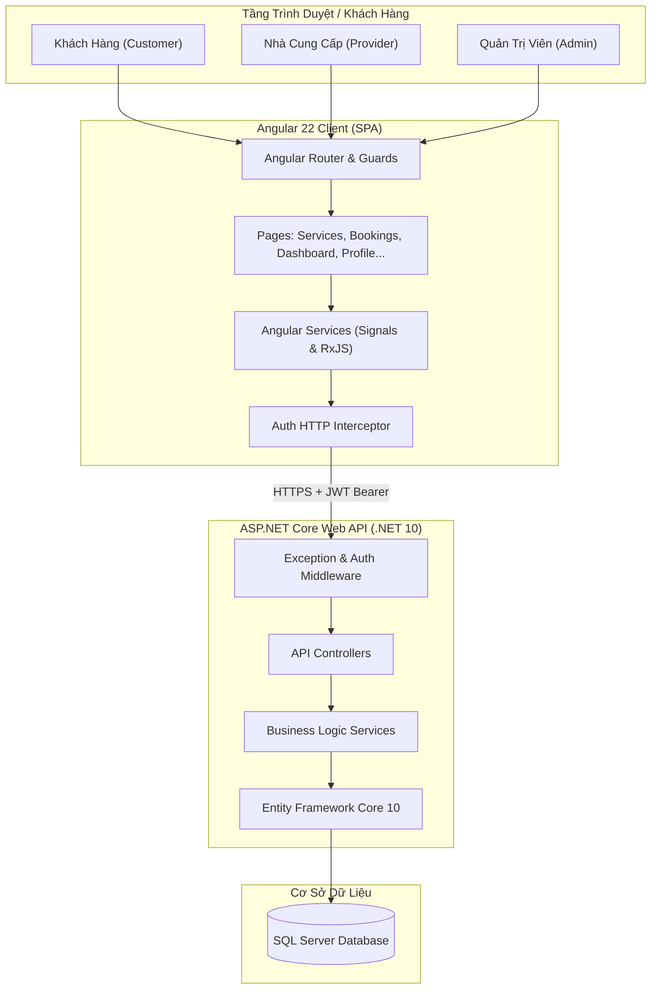
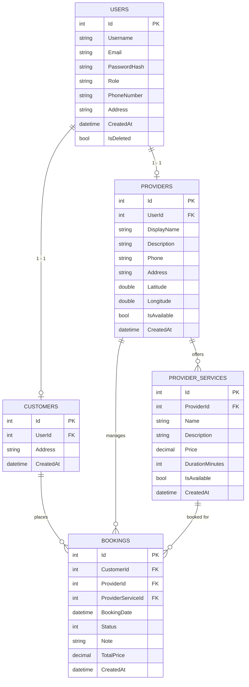
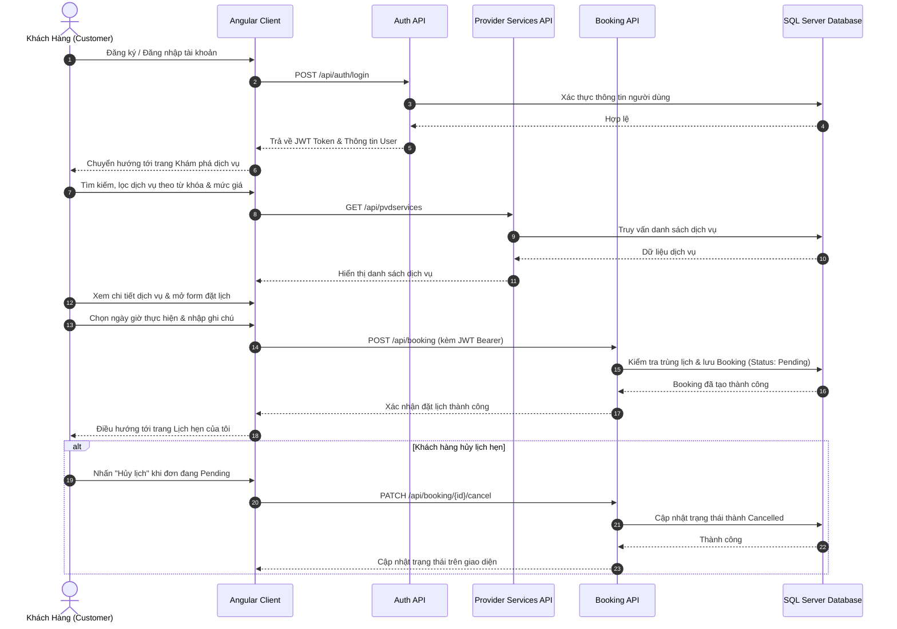
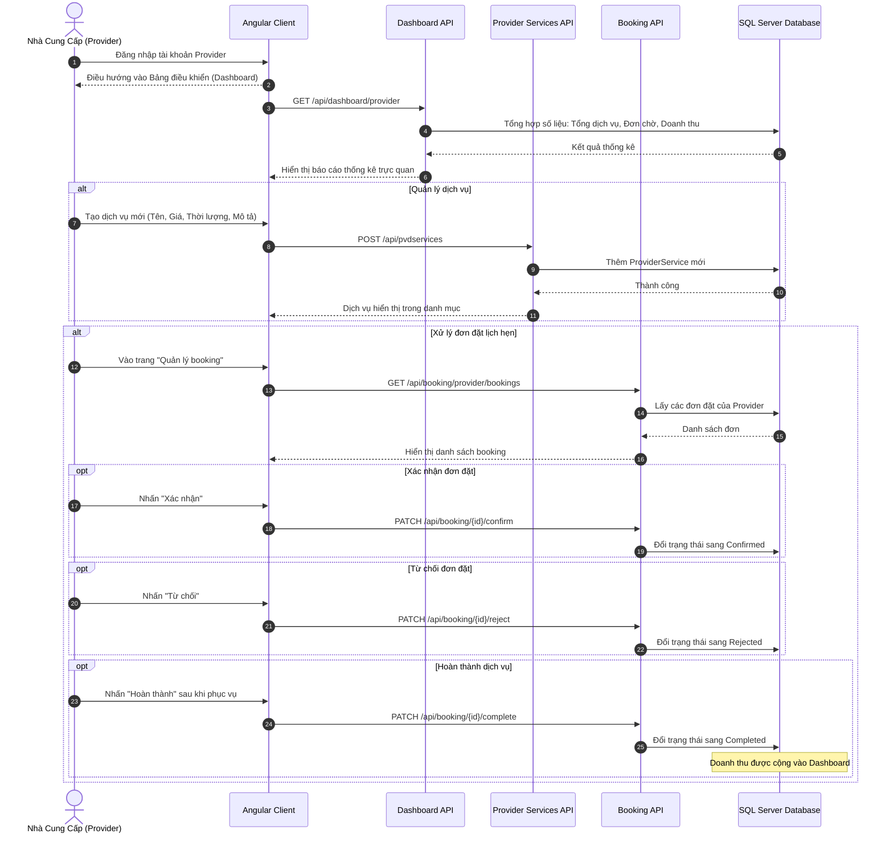
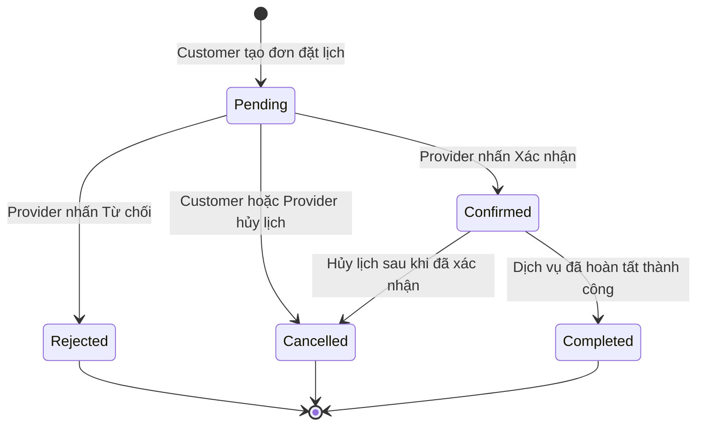

# ServiceBooking - Nền Tảng Đặt Lịch Dịch Vụ Trực Tuyến

ServiceBooking là hệ thống đặt lịch dịch vụ hoàn chỉnh gồm **ASP.NET Core Web API (.NET 10)** cho backend và **Angular 22 (Standalone Components & Signals)** cho frontend. Hệ thống hỗ trợ đa vai trò (Khách hàng - `Customer`, Nhà cung cấp - `Provider`, Quản trị viên - `Admin`), cung cấp quy trình khép kín từ khám phá dịch vụ, đặt lịch, quản lý đơn đặt, phê duyệt/từ chối lịch hẹn đến thống kê doanh thu và quản lý hồ sơ nhà cung cấp.

---

## 1. Công nghệ sử dụng

### Backend: `ServiceBooking.Api`
- **Nền tảng**: .NET 10 Web API
- **ORM & Database**: Entity Framework Core 10, SQL Server / LocalDB
- **Xác thực & Phân quyền**: JWT Bearer Authentication, BCrypt Password Hashing, Role-based Access Control (`Customer`, `Provider`, `Admin`)
- **Kiến trúc**: Layered Architecture (Controllers → Services → DTOs → Models → Data)
- **Tài liệu API**: OpenAPI / Swagger UI tích hợp xác thực Bearer Token
- **Tự động hóa**: Tự động migrate và seed tài khoản quản trị khi khởi động

### Frontend: `ServiceBooking.Client`
- **Framework**: Angular 22
- **Mô hình lập trình**: Standalone Components, Signal-based reactivity, `inject()` API
- **Routing & Bảo mật**: Angular Router với Lazy Loading, Route Guards (`authGuard`, `roleGuard`), HTTP Interceptor tự động gắn Bearer Token
- **Quản lý Form**: Angular Reactive Forms với validation chi tiết
- **Giao diện**: Modern CSS, Responsive Design cho Desktop & Mobile

---

## 2. Kiến trúc tổng quan hệ thống



---

## 3. Sơ đồ cơ sở dữ liệu quan hệ (ERD)



---

## 4. Sơ đồ quy trình nghiệp vụ (Business Workflows)

### 4.1. Quy trình dành cho Khách hàng (Customer Journey)



### 4.2. Quy trình dành cho Nhà cung cấp (Provider Journey)



### 4.3. Vòng đời trạng thái Đơn đặt lịch (Booking Lifecycle)



---

## 5. Danh mục API Endpoints

| Phân hệ | Phương thức | Endpoint | Phân quyền | Mô tả |
| :--- | :--- | :--- | :--- | :--- |
| **Auth** | `POST` | `/api/auth/register` | Public | Đăng ký tài khoản (`Customer` hoặc `Provider`) |
| **Auth** | `POST` | `/api/auth/login` | Public | Đăng nhập và nhận JWT Bearer Token |
| **Dashboard**| `GET` | `/api/dashboard/provider` | Provider | Thống kê số dịch vụ, số đơn và doanh thu |
| **Booking** | `POST` | `/api/booking` | Customer | Tạo đơn đặt lịch hẹn mới |
| **Booking** | `GET` | `/api/booking/customer/bookings` | Customer | Xem danh sách lịch hẹn của tôi |
| **Booking** | `GET` | `/api/booking/provider/bookings` | Provider | Xem danh sách lịch hẹn được đặt |
| **Booking** | `GET` | `/api/booking/{id}` | All Auth | Xem chi tiết thông tin đơn đặt lịch |
| **Booking** | `PATCH` | `/api/booking/{id}/cancel` | All Auth | Hủy lịch hẹn (trạng thái Pending) |
| **Booking** | `PATCH` | `/api/booking/{id}/confirm` | Provider | Xác nhận tiếp nhận lịch hẹn |
| **Booking** | `PATCH` | `/api/booking/{id}/reject` | Provider | Từ chối tiếp nhận lịch hẹn |
| **Booking** | `PATCH` | `/api/booking/{id}/complete` | Provider | Xác nhận hoàn thành dịch vụ |
| **Services**| `GET` | `/api/pvdservices` | All Auth | Lấy toàn bộ danh sách dịch vụ đang mở |
| **Services**| `GET` | `/api/pvdservices/{id}` | All Auth | Lấy chi tiết một dịch vụ |
| **Services**| `GET` | `/api/pvdservices/provider/{providerId}`| All Auth | Xem dịch vụ của một nhà cung cấp cụ thể |
| **Services**| `POST` | `/api/pvdservices` | Provider | Tạo mới một dịch vụ |
| **Services**| `PUT` | `/api/pvdservices/{id}` | Provider | Cập nhật thông tin dịch vụ |
| **Services**| `DELETE`| `/api/pvdservices/{id}` | Provider | Xóa một dịch vụ |
| **Provider**| `GET` | `/api/providers/profile` | Provider | Lấy thông tin hồ sơ của provider hiện tại |
| **Provider**| `PUT` | `/api/providers/profile` | Provider | Cập nhật hồ sơ nhà cung cấp |
| **Provider**| `GET` | `/api/providers/{id}` | All Auth | Xem thông tin công khai của nhà cung cấp |
| **Customer**| `GET` | `/api/customers/profile` | Customer | Lấy hồ sơ khách hàng hiện tại |
| **Users** | `GET/POST/PUT/DELETE` | `/api/users` | Admin | Quản lý danh sách người dùng hệ thống |

---

## 6. Chức năng Frontend theo vai trò

### Dành cho Khách hàng (`Customer`)
- **Trang đăng ký / đăng nhập**: Đăng ký vai trò Khách hàng, lưu trữ JWT và tự động phân luồng.
- **Khám phá dịch vụ (`/customer/services`)**:
  - Tìm kiếm thời gian thực theo tên hoặc mô tả dịch vụ.
  - Bộ lọc khoảng giá: Dưới 100k, 100k - 500k, Trên 500k.
  - Xem huy hiệu trạng thái sẵn sàng phục vụ của từng dịch vụ.
- **Chi tiết dịch vụ & Đặt lịch (`/services/:id`)**:
  - Xem chi tiết thời lượng, đơn giá và mô tả dịch vụ.
  - Chọn ngày giờ hẹn, nhập ghi chú yêu cầu đặc biệt.
  - Kiểm tra hợp lệ thời gian đặt hẹn và xử lý lỗi trùng lịch.
- **Quản lý lịch hẹn (`/customer/bookings`)**:
  - Theo dõi danh sách đơn đặt theo thẻ trực quan.
  - Nhãn màu trạng thái: Chờ duyệt (vàng), Đã duyệt (xanh), Đã từ chối (đỏ), Hoàn thành (xanh lá), Đã hủy (xám).
  - Nút Hủy lịch với các đơn đang chờ duyệt.

### Dành cho Nhà cung cấp (`Provider`)
- **Bảng điều khiển (`/provider/dashboard`)**:
  - Thẻ thống kê: Tổng doanh thu từ các đơn hoàn thành, Tổng số dịch vụ, Số đơn chờ duyệt, Đã duyệt, Đã hoàn thành.
  - Lối tắt nhanh tới các chức năng chính.
- **Quản lý dịch vụ (`/provider/services`)**:
  - Xem toàn bộ danh sách dịch vụ do mình cung cấp.
  - Nút thêm mới và xóa dịch vụ.
- **Tạo dịch vụ mới (`/provider/services/create`)**:
  - Form khai báo tên, giá, thời lượng thực hiện và mô tả.
- **Quản lý đơn đặt lịch (`/provider/bookings`)**:
  - Duyệt đơn (Xác nhận), Từ chối đơn (Reject) khi đơn ở trạng thái Pending.
  - Đánh dấu hoàn thành (Complete) sau khi đã phục vụ khách hàng.
- **Hồ sơ nhà cung cấp (`/provider/profile`)**:
  - Cập nhật tên thương hiệu, số điện thoại, địa chỉ làm việc, giới thiệu.
  - Nút bật/tắt trạng thái nhận lịch hẹn.

---

## 7. Cấu trúc thư mục dự án

```text
ServiceBooking/
|-- ServiceBooking.Api/                  # Backend ASP.NET Core .NET 10
|   |-- Controllers/                    # API Endpoints
|   |   |-- AuthController.cs
|   |   |-- BookingController.cs
|   |   |-- CustomerController.cs
|   |   |-- DashboardController.cs
|   |   |-- ProvidersController.cs
|   |   |-- ProviderServicesController.cs
|   |   `-- UserController.cs
|   |-- Data/                           # Database Context & Seeder
|   |   |-- AppDbContext.cs
|   |   `-- DbSeeder.cs
|   |-- DTOs/                           # Data Transfer Objects
|   |   |-- Auth/
|   |   |-- Booking/
|   |   |-- Customers/
|   |   |-- Providers/
|   |   |-- ProviderService/
|   |   `-- User/
|   |-- Models/                         # Domain Entities
|   |   |-- Booking.cs
|   |   |-- BookingStatus.cs
|   |   |-- Customer.cs
|   |   |-- Provider.cs
|   |   |-- ProviderService.cs
|   |   `-- User.cs
|   |-- Services/                       # Business Logic Layer
|   |   |-- Interfaces/
|   |   `-- Implementations/
|   |-- Middlewares/                    # Global Exception Handler
|   |-- Program.cs                      # Dependency Injection & Pipeline
|   `-- appsettings.json
|
|-- ServiceBooking.Client/               # Frontend Angular 22
|   |-- src/
|   |   |-- app/
|   |   |   |-- components/             # Reusable UI components
|   |   |   |   |-- navbar/
|   |   |   |   |-- booking-card/
|   |   |   |   `-- service-card/
|   |   |   |-- guards/                 # authGuard, roleGuard
|   |   |   |-- interceptors/           # authInterceptor
|   |   |   |-- pages/                  # Routed Feature Pages
|   |   |   |   |-- login/
|   |   |   |   |-- register/
|   |   |   |   |-- home/
|   |   |   |   |-- forbidden/
|   |   |   |   |-- services/
|   |   |   |   |   |-- create-service/
|   |   |   |   |   `-- service-detail/
|   |   |   |   |-- bookings/
|   |   |   |   |-- provider-dashboard/
|   |   |   |   `-- provider-profile/
|   |   |   |-- services/               # Angular Services (API calls)
|   |   |   |-- app.config.ts
|   |   |   |-- app.routes.ts
|   |   |   `-- app.ts
|   |   |-- environments/               # environment configs
|   |   |-- index.html
|   |   `-- styles.css
|   |-- angular.json
|   `-- package.json
|
`-- README.md
```

---

## 8. Cài đặt và chạy dự án

### Yêu cầu môi trường
- [.NET 10 SDK](https://dotnet.microsoft.com/)
- [Node.js](https://nodejs.org/) (phiên bản v20+ hoặc v24+)
- SQL Server hoặc LocalDB

### 1. Cấu hình Backend
Tạo hoặc kiểm tra file `ServiceBooking.Api/appsettings.Development.json`:
```json
{
  "ConnectionStrings": {
    "DefaultConnection": "Server=(localdb)\\mssqllocaldb;Database=ServiceBookingDb;Trusted_Connection=True;MultipleActiveResultSets=true"
  },
  "JWT": {
    "Key": "SuperSecretKeyForJwtAuthenticationServiceBookingSystem2026!",
    "Issuer": "ServiceBookingApi",
    "Audience": "ServiceBookingClient",
    "ExpirationInMinutes": 120
  },
  "AllowedOrigins": [
    "http://localhost:4200"
  ]
}
```

### 2. Chạy Migration CSDL
```bash
cd ServiceBooking.Api
dotnet ef database update
```
*(Nếu database chưa có, hệ thống cũng có DbSeeder tự động khởi tạo khi chạy API)*

### 3. Chạy Backend Web API
```bash
cd ServiceBooking.Api
dotnet run
```
Backend API sẽ khởi động và Swagger UI sẵn sàng tại: `https://localhost:5001/swagger` hoặc `http://localhost:5000/swagger`.

### 4. Chạy Frontend Angular
```bash
cd ServiceBooking.Client
npm install
npm start
```
Ứng dụng Angular sẽ chạy tại: `http://localhost:4200`.

---

